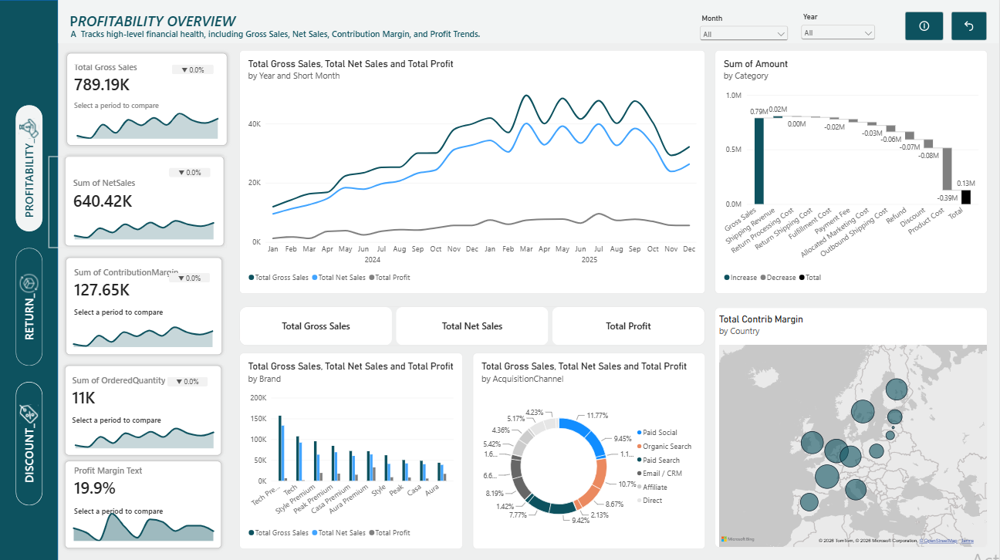
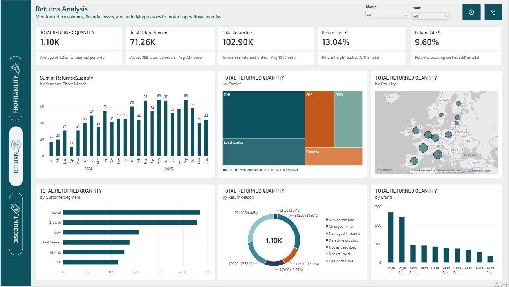
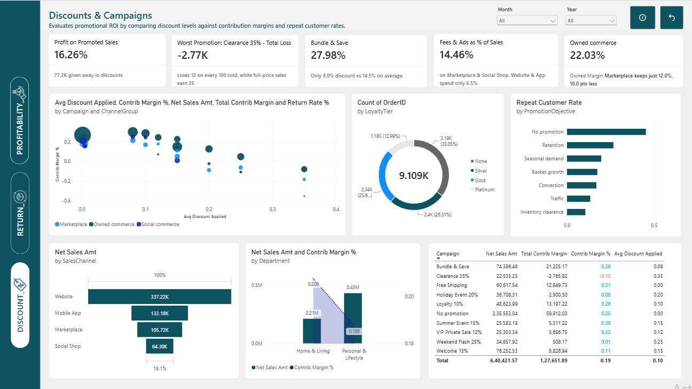

# E-commerce Profitability, Returns & Promotions Dashboard (Power BI)

A 3-page Power BI report that shows where an online retailer makes and loses money across sales, returns, promotions and sales channels. Built for **[CHALLENGE NAME, MONTH YEAR]** using the dataset provided by the challenge.



## Business questions

1. How are sales and profit changing, and what drives the margin?
2. How many orders come back, which carriers and reasons cause it, and what does it cost?
3. Do promotions and sales channels make money, or give it away?

## Dataset

- Source: [LINK TO CHALLENGE / DATASET PAGE]
- 9,109 order lines in 5,873 orders, 2024 to 2025
- 2,200 customers, 60 products, 24 locations, 10 promotions
- All values are in EUR

## Data model

Star schema built in Power BI:

- **Fact table:** `tblFactOrderLine` (one row per order line)
- **Dimensions (8 relationships):** `tblDimDate`, `tblDimProduct`, `tblDimCustomer`, `tblDimGeography`, `tblDimPromotion`, `tblDimFulfillment`, `tblDimSalesChannel`, `tblDimReturnReason`
- **Helper tables:** a field parameter table for the metric switch, and `tbl_MarginBridgeData` for the margin waterfall
- The calendar table (`tblDimDate`) was built in Power Query

## Report pages

| Page | Focus | What it shows |
|------|-------|---------------|
| 1. Sales and Profit | How are we doing? | Gross sales, net sales, quantity and contribution margin with change vs the previous period; a switch between gross sales, net sales and profit by month, brand and acquisition channel; a margin bridge waterfall; margin by city on a map |
| 2. Returns | What do returns cost? | Returned units, refund amount, return loss, return loss % and return rate by month, carrier, country, customer segment, return reason and brand |
| 3. Promotions and Channels | Do promotions pay off? | Margin on promoted sales, best and worst promotion, best channel, cost to serve; promotion scatter, loyalty tiers, repeat customer rate, channel funnel, category margin |

All pages have year and month slicers and navigation buttons.




## Key findings

- **Profit:** contribution margin was about €128K on €640K of net sales (about 20%). Net sales grew about 71% from 2024 to 2025, and contribution margin % improved from 17.3% to 20.7%.
- **Promotions cost margin:** promoted sales earned a 16.3% margin against 24.9% at full price.
- **Best and worst promotions:** Bundle & Save was the best at 28.0%. Clearance 35% lost money (margin of -11.6%), and Weekend Flash 25% earned only 1.4%.
- **Channels:** owned channels earned about 22% margin, against about 12% for marketplace and social.
- **Returns:** about 9.6% of ordered units were returned, costing about €103K (13% of gross sales). GLS (12.2%) and the local carrier (11.6%) had higher return rates than Omniva (7.0%). "Changed mind" and "size or fit" were the most common reasons.

## DAX highlights

The report has about 70 measures. Some of the analytical ones:

```DAX
Contrib Margin % =
DIVIDE ( [Total Contrib Margin], [Total Contrib Rev] )
```
Contribution margin as a share of contribution revenue. Most other margin measures build on this one.

```DAX
Promo Margin % =
CALCULATE ( [Contrib Margin %], tblDimPromotion[PromotionKey] <> "PR00" )
```
The same margin, but only for sales that had a promotion (PR00 means no promotion). Comparing it with the full-price margin shows the cost of discounting.

```DAX
Repeat Customer Count =
VAR CustOrders =
    ADDCOLUMNS (
        VALUES ( tblFactOrderLine[CustomerKey] ),
        "OrderCnt", CALCULATE ( DISTINCTCOUNT ( tblFactOrderLine[OrderID] ) )
    )
RETURN
    COUNTROWS ( FILTER ( CustOrders, [OrderCnt] > 1 ) )
```
Counts customers who placed more than one order. Dividing it by the total customer count gives the repeat customer rate.

Other techniques: previous-period measures that switch between last month and last year depending on which slicers are filtered (`ISFILTERED`, `DATEADD`), `TOPN` to find the best and worst promotion, and dynamic text for the KPI cards.

## Tools

Power BI Desktop, Power Query, DAX

## Files

```
ecommerce-profitability-powerbi/
├── README.md
├── dashboard.pdf
└── screenshots/
    ├── page1-sales-profit.png
    ├── page2-returns.png
    └── page3-promotions-channels.png
```

The `.pbix` file is 53 MB, which is too large for this repo. Download it here: [GOOGLE DRIVE LINK]

## How to open

1. Download the `.pbix` file from the link above.
2. Open it in Power BI Desktop (free from Microsoft).
3. If Power BI asks about the data source, point it to the challenge dataset from the link above.

Or open `dashboard.pdf` to see all pages.

## Notes

- The dataset came with the challenge and was already clean, so most of the work here is data modelling, DAX and dashboard design.
- Walkthrough video: [YOUTUBE LINK, optional]

## Author

Sunny Kashyap | [LinkedIn](LINK) | kashyapsunny0134@gmail.com
